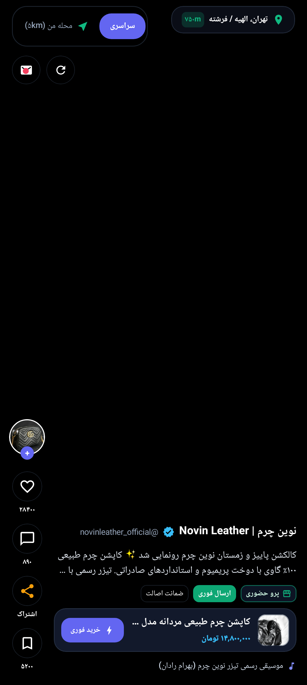
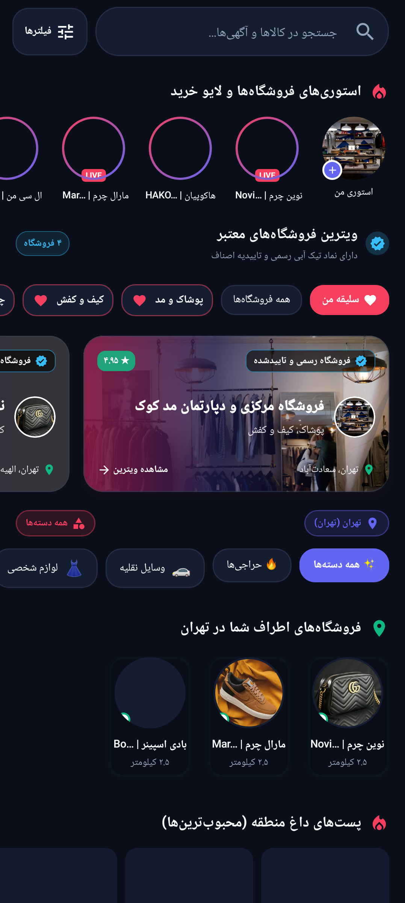
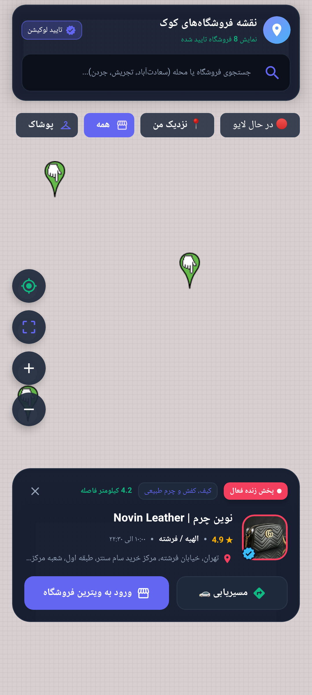
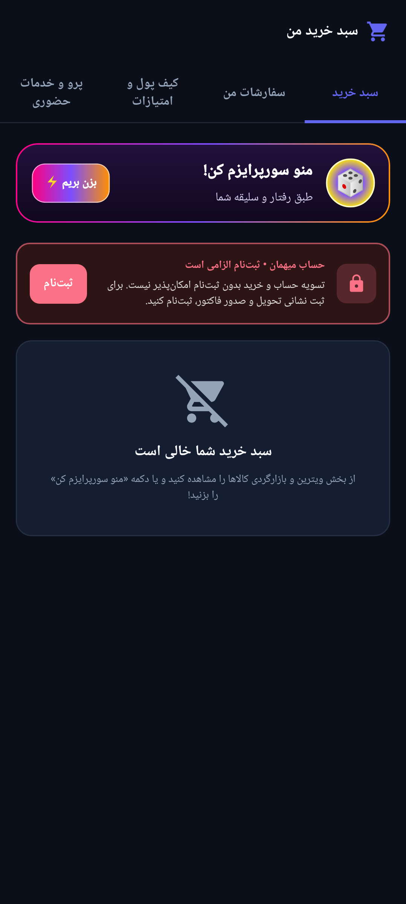
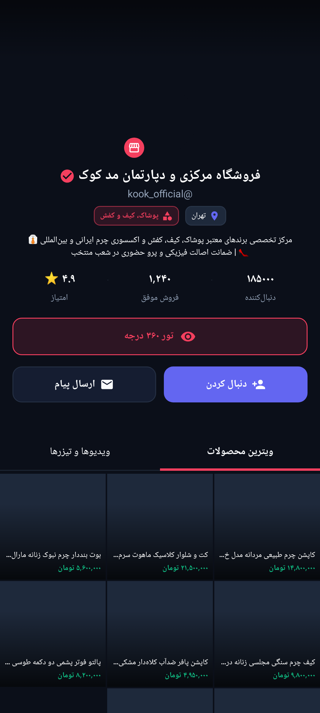
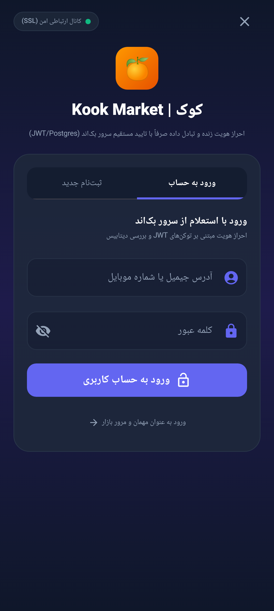

# اسکرین‌شات‌های اپلیکیشن کوک (Kook)

در ادامه اسکرین‌شات‌های واقعی رندر شده (از طریق موتور Jetpack Compose + Roborazzi روی ابعاد Pixel 8 و چیدمان راست‌به‌چپ فارسی) از صفحات اصلی اپلیکیشن قرار داده شده است:

---

## ۱. صفحه فید ویدیویی و ویترین (Feed Screen)
- نمایش تمام‌صفحه ویدیوهای محصول به همراه انتخابگر موقعیت مکانی (`محله من (5km)` / `سراسری`)
- کارت شیشه‌ای (Glassmorphic) مشخصات کالا، قیمت، تگ‌های «پرو حضوری»، «ارسال فوری» و «ضمانت اصالت»
- دکمه‌های تعاملی لایک، دیدگاه، اشتراک‌گذاری، ذخیره و «خرید فوری»

---

## ۲. صفحه اکسپلور و بازارگردی (Discover Screen)
- جستجوی هوشمند در کالاها و آگهی‌ها به همراه فیلترهای پیشرفته (سبک دیوار)
- استوری‌ها و پخش زنده (LIVE) فروشگاه‌های منتخب
- کارت‌های فروشگاه‌های رسمی دارای تیک آبی اصناف و دسته‌بندی‌های متنوع

---

## ۳. نقشه تعاملی فروشگاه‌های حضوری (Map Screen)
- نمایش موقعیت فروشگاه‌های تاییدشده روی نقشه به همراه فیلترهای «در حال لایو»، «نزدیک من» و دسته‌بندی‌ها
- کارت پیش‌نمایش فروشگاه در پایین صفحه شامل امتیاز، فاصله، وضعیت پخش زنده، دکمه مسیریابی و ورود مستقیم به ویترین فروشگاه

---

## ۴. سبد خرید، سفارشات و کیف پول (Wallet & Cart Screen)
- مدیریت یکپارچه «سبد خرید»، «سفارشات من»، «کیف پول و امتیازات» و «پرو و خدمات حضوری»
- قابلیت پیشنهاد هوشمند کالا («منو سورپرایزم کن!») بر اساس سلیقه کاربر

---

## ۵. پروفایل و ویترین اختصاصی فروشگاه (Store Profile Screen)
- نمایش اطلاعات فروشگاه، آمار دنبال‌کنندگان، تیک آبی تایید هویت، آدرس، ساعت کاری و ویترین محصولات و ویدیوها

---

## ۶. صفحه ورود و ثبت‌نام (Auth Screen)
- احراز هویت امن کاربران و فروشندگان با پشتیبانی از ورود و ثبت‌نام سریع

